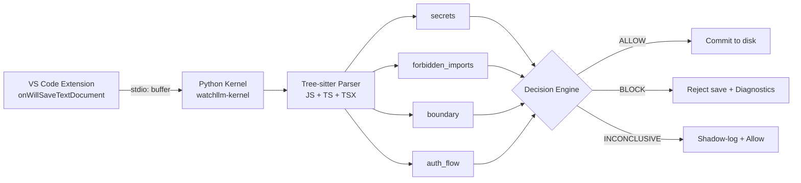

<div align="center">
  
</div>

# WatchLLM Open Source

### Open components for deterministic governance of autonomous coding agents.

WatchLLM Open Source contains the publicly available components of the WatchLLM system: source analysis, deterministic policy enforcement, editor integration, and selected evidence/verification infrastructure.

---

## Public and private components

This repository is the public/open-source surface of WatchLLM.

The broader WatchLLM system also contains private development components and integrations. This repository should not be interpreted as a complete mirror of the private monorepo.

The public components are intended to be independently understandable and usable within the scope described below.

---

## Who this is for

- developers experimenting with agent governance;
- researchers exploring deterministic code-policy enforcement;
- teams building coding-agent tooling;
- engineers interested in AST-based source analysis;
- contributors working on safe developer infrastructure.

---

## What is included

- **Deterministic Evaluation Kernel (`kernel/`)**: AST-based static rule evaluation engine (`watchllm-kernel`) using Tree-sitter for JavaScript, TypeScript, and TSX. Evaluates secrets, forbidden imports, module boundaries, and authorization-flow order.
- **Canonical Schema Contracts (`schemas/`)**: JSON Schema (Draft-07) specifications defining events, violations, decisions, and kernel execution result payloads.
- **Editor Interceptor (`vscode/`)**: TypeScript VS Code extension integrating with `onWillSaveTextDocument` to enforce pre-save blocking and inline editor diagnostics via stdio IPC.
- **Evidence & Verification SDK (`webproof/`)**: Public Python SDK (`watchllm-webproof`) for recording privacy-minimized HTTP request outcomes into a local SHA-256 Merkle accumulator.
- **Curated Scenario Fixtures (`examples/`)**: Concrete safe and unsafe code samples demonstrating policy enforcement across secrets, boundaries, and auth-flow patterns.

---

## What is not included

- **High-Performance Rust Runtime**: The closed-source production execution engine used in WatchLLM Cloud.
- **Forensics & DAG Replay System**: Private recording, execution replay, and investigation dashboard.
- **Remote Proof Settlement & Blockchain Attestation**: Production Merkle proof anchoring, distributed lease/queue consensus, and cryptographic attestation pipelines.
- **Cloud Infrastructure & Production SLA**: Hosted governance services, multi-tenant databases, and enterprise SLAs.

---

## Architecture

The open-source pipeline enforces governance deterministically before code changes reach the filesystem:



---

## Quickstart

Clone the repository and install the kernel in editable mode:

```bash
git clone https://github.com/WatchLLM/watchllm-oss.git
cd watchllm-oss/kernel
pip install -e .
```

Run the smallest working example:

```bash
echo "async function handler(req) { await db.user.delete(req.userId); await auth.verify(req.token); }" | watchllm-kernel check --stdin --language ts
```

Expected output:

```
Decision: BLOCK
File: <stdin>
Language: typescript
Mode: enforce
  - Protected operation occurs before auth verification. at line 1, col 37
```

Testing safe code:

```bash
echo "async function handler(req) { await auth.verify(req.token); await db.user.delete(req.userId); }" | watchllm-kernel check --stdin --language ts
```

Expected output:

```
Decision: ALLOW
File: <stdin>
Language: typescript
Mode: enforce
Violations: none
```

---

## Example policy

WatchLLM projects configure evaluation rules through `.watchllm.yaml` in the project root:

```yaml
rules:
  auth_flow:
    enabled: true
    severity: error
  secrets:
    enabled: true
    severity: error
  forbidden_imports:
    enabled: true
    severity: error
    modules:
      - child_process
      - net
  boundary:
    enabled: true
    severity: error
```

---

## Example

Input (`handler.ts`):

```ts
export async function handler(req, db, auth) {
  // Destructive mutation executed before auth verification
  await db.user.delete({ id: req.userId });
  await auth.verify(req);
}
```

Running the check:

```bash
watchllm-kernel check --filepath handler.ts
```

---

## Example output

Standard terminal output:

```
Decision: BLOCK
File: handler.ts
Language: typescript
Mode: enforce
  - Protected operation occurs before auth verification. at line 3, col 3
```

Structured JSON output (`watchllm-kernel check --filepath handler.ts --json`):

```json
{
  "decision": "BLOCK",
  "rule_results": [
    {
      "rule_id": "watchllm-rule-auth",
      "status": "FAIL",
      "violations": [
        {
          "rule_id": "watchllm-rule-auth",
          "message": "Protected operation occurs before auth verification.",
          "location": {
            "line": 3,
            "column": 3,
            "end_line": 3,
            "end_column": 43
          },
          "severity": "HIGH",
          "evidence": "db.user.delete"
        }
      ]
    }
  ],
  "file_path": "handler.ts",
  "language": "typescript",
  "mode": "enforce"
}
```

---

## Development

### Kernel test suite

Run the test suite across parser tests, individual rules, and JSON schema contract checks:

```bash
cd kernel
pip install -e .
pytest
```

### VS Code extension

Build the extension locally:

```bash
cd vscode
npm install
npm run compile
```

### Schemas validation

Schema contracts are stored in `schemas/schemas/v1/` as Draft-07 JSON Schemas. Tests in `kernel/tests/test_cli_contract.py` assert that all kernel outputs strictly adhere to these definitions.

---

## Project structure

| Directory | Description |
|---|---|
| [`kernel/`](./kernel) | Python evaluation kernel (`watchllm-kernel`) with Tree-sitter AST parser and rule implementations. |
| [`schemas/`](./schemas) | Canonical JSON Schema (Draft-07) specifications for events, violations, and decisions. |
| [`vscode/`](./vscode) | TypeScript VS Code extension handling `onWillSaveTextDocument` pre-save hooks and diagnostics. |
| [`webproof/`](./webproof) | Public Python SDK (`watchllm-webproof`) for local privacy-preserving Merkle summaries. |
| [`examples/`](./examples) | Curated safe and unsafe scenario fixtures for testing and onboarding. |

---

## Relationship to the private monorepo

WatchLLM OSS contains the open-core deterministic analysis logic, schema definitions, and editor integration contracts extracted from the private development monorepo.

- **Open Core**: Static AST analysis, 3-valued policy evaluation (`PASS`, `FAIL`, `INCONCLUSIVE`), schema contracts, and local editor interception.
- **Private Systems**: Closed-source Rust runtime, execution DAG replays, forensic investigation tools, and enterprise proof settlement infrastructure.

The open components operate completely independently without dependencies on any private cloud services or proprietary modules.

---

## Current limitations

- **Status**: experimental (v0.1.1).
- **Language support**: Currently covers JavaScript, TypeScript, and TSX. Python and other languages are planned.
- **Control flow**: Analyzes scope and conditional branching conservatively; ambiguous execution paths return `INCONCLUSIVE` (shadow-logged) rather than attempting full abstract interpretation.
- **Editor extension**: Functional for local development; not currently published to the Visual Studio Marketplace.
- **WebProof module**: Computes a local deterministic SHA-256 Merkle accumulator; does not produce hardware-attested TLS proofs or interact with remote zero-knowledge provers.

---

## License

MIT License — see [LICENSE](./LICENSE).
