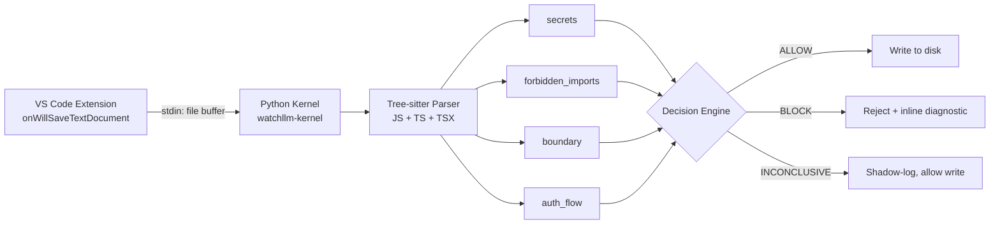

<div align="center">
  
</div>

# WatchLLM — Open Core

A deterministic governance kernel that intercepts autonomous agent file writes, parses the code using a Tree-sitter Abstract Syntax Tree, and blocks unsafe operations before they reach disk.

[Website](https://watchllm.dev) · [Docs](https://docs.watchllm.dev) · [License: MIT](./LICENSE)

---

## The problem

Autonomous coding agents (Aider, Claude Code, OpenCode) generate code without any awareness of a project's security boundaries. They routinely produce code that:

- embeds API keys directly in source files
- imports sandboxed or dangerous modules (`child_process`, `net`)
- calls database mutations inside handlers that have no authentication check in scope

These errors are systematic, not occasional. A tool that governs the write path deterministically — before the code ever touches the filesystem — removes an entire class of agent failure mode.

---

## Architecture

The kernel intercepts `onWillSaveTextDocument` in VS Code, passes the document buffer to the Python evaluation engine via stdio, and returns a decision before the write commits.



**Enforce mode**: violations cancel the save via `event.waitUntil()` and surface as inline diagnostics.
**Shadow mode**: violations are logged to `.watchllm/logs/violations.jsonl` without blocking.

---

## What I built

This repository contains the open-core components extracted from the private WatchLLM monorepo:

| Component | Description |
|---|---|
| `kernel/` | Python evaluation kernel. Runs Tree-sitter parsing and all four deterministic rules. Packaged as `watchllm-kernel` on PyPI. |
| `schemas/` | JSON Schema (Draft-07) contracts for `event`, `violation`, `decision`, and `kernel_execution_result`. Shared with the closed-source Rust runtime via the same contracts. |
| `vscode/` | TypeScript VS Code extension. Manages the `onWillSaveTextDocument` lifecycle, spawns the kernel subprocess, and renders diagnostics. Not published to the Marketplace — runs locally. |
| `examples/` | Scenario fixtures demonstrating each rule category. Used in the kernel test suite. |

---

## Technical challenges

### Auth-flow rule: 3-valued logic over ambiguous control flow

The hardest rule to implement correctly is the auth-flow check: does an authentication call (`auth.verify`, `requireAuth`) always execute before a protected mutation (`db.insert`, `db.update`, `db.delete`) inside a request handler?

Static analysis on a flat AST is straightforward. The difficulty is control flow: if the auth guard is inside a `try` block, a conditional, or a `switch` arm, you cannot prove it executes on every path without a full abstract interpreter.

The kernel avoids both false positives (blocking valid code) and false negatives (missing real issues) by using three output states:

- `PASS` — an unconditional auth call precedes all detected mutations.
- `FAIL` — a mutation occurs before any auth call.
- `INCONCLUSIVE` — an auth call exists but only inside a branch. The violation is logged; the save is not blocked.

`INCONCLUSIVE` exists so the tool does not obstruct a developer working inside a complex handler. The ambiguity is flagged without halting the write.

Handler detection covers three syntactic forms: named function declarations, arrow functions assigned to handler-like variable names, and `export default function` handlers. Source: [`kernel/src/watchllm_kernel/rules/auth_flow.py`](./kernel/src/watchllm_kernel/rules/auth_flow.py).

### Fail-open timeout

The VS Code extension enforces an 800 ms deadline on the kernel subprocess. If the kernel does not respond within that window, the extension allows the save and logs the timeout. Governance must not make the editor unreliable.

---

## Quick start

```bash
# Install the kernel
pip install watchllm-kernel

# Scan a local directory
watchllm-kernel scan ./my-project

# Run against a single file
watchllm-kernel check ./src/api/users.ts
```

To run the VS Code extension locally, follow the steps in [`vscode/README.md`](./vscode/README.md). The extension is not published to the Marketplace.

---

## Current status and limitations

**Status: experimental.** Kernel is at v0.1.1.

- Language support is limited to JavaScript and TypeScript (including TSX). Python and other languages are not yet implemented.
- The `boundary` rule requires a `watchllm.yaml` config file in the project root to define module boundaries. Without it, boundary checks are skipped.
- The VS Code extension is functional but not packaged for distribution.
- The closed-source Rust runtime, used in WatchLLM Cloud, is not part of this repository.

---

## Verification

The kernel ships with a test suite against the fixtures in `examples/`. To run:

```bash
cd kernel
pip install -e .
pytest
```

JSON Schema contracts in `schemas/` are validated against all kernel outputs during the test run.
