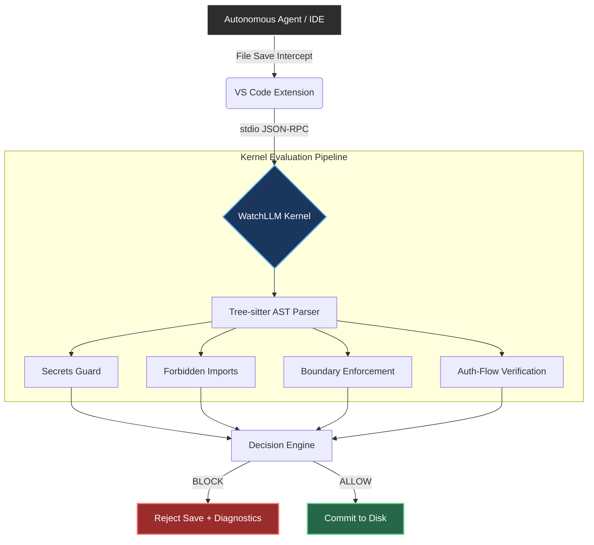

<div align="center">
  

  **Deterministic agent governance — an open-core platform for safe autonomous coding agents.**

  [](https://opensource.org/licenses/MIT)
  [](https://www.python.org/downloads/)
  [](#)

  [Website](https://watchllm.dev) · [Documentation](https://docs.watchllm.dev)
</div>

---

### 🚀 TL;DR (For Non-Technical Reviewers)
**Think of WatchLLM as an enterprise-grade antivirus specifically built for AI coding agents.** When an autonomous AI writes code, it often introduces massive security vulnerabilities or breaks system architectures. WatchLLM intercepts the AI's code *before* it is saved to the hard drive, mathematically proves its safety, and instantly blocks any malicious or rule-breaking actions. 

---

<div align="center">
  <h3>🔥 WatchLLM in Action</h3>
  <!-- TODO: Replace this placeholder with a 10-15 second GIF showing VS Code intercepting a malicious AI save -->
  <p><i>[INSERT 10-SECOND GIF HERE: Displaying WatchLLM blocking an agent from exposing an API key in VS Code]</i></p>
</div>

---

## 🧠 What is WatchLLM?

WatchLLM is a high-performance, deterministic runtime governance platform. It intercepts file operations generated by autonomous agents, parses the raw code into an Abstract Syntax Tree (AST) using `tree-sitter`, and enforces strict boundary, auth-flow, and cryptographic secrets rules in real-time. Unsafe writes are blocked via IPC before the filesystem is mutated.

This repository contains the **Open-Core Engine** of WatchLLM:
*   The deterministic Python evaluation kernel.
*   The canonical JSON Schema contracts.
*   The VS Code extension interceptor.

## 🏗️ System Architecture

WatchLLM strictly separates IDE-layer interception from the cryptographic kernel evaluation. 



## ⚙️ Core Engineering Complexities

### Context-Aware AST Control-Flow Ordering
A primary challenge in agent governance is preventing false-positive blocks when security rules are nested inside complex control-flow branches (e.g., `try/catch`, `switch`, dynamic `if` statements).

WatchLLM solves this by implementing **Context-Aware AST Control-Flow Ordering without Full Abstract Interpretation**. 
1. The engine accurately extracts the call graph strictly within multi-paradigm handler scopes (differentiating arrow functions, named declarations, and closures).
2. It executes a topological AST traversal using a proprietary **Three-Valued Logic Engine (`PASS`, `FAIL`, `INCONCLUSIVE`)**.
3. If an autonomous agent places a database mutation inside a conditionally ambiguous branch where an authentication guard *cannot* be cryptographically guaranteed to execute first, the engine returns `INCONCLUSIVE` (shadow-logging the anomaly) rather than crashing the agent pipeline with a naive false-positive `FAIL`.

## 📂 Repository Structure

| Directory | Core Function |
|-----------|-------------|
| [`kernel/`](./kernel) | Deterministic evaluation kernel executing Tree-sitter AST parsing and the 3-valued rule engine. |
| [`schemas/`](./schemas) | Canonical JSON Schema (Draft-07) contracts ensuring strict typing across the Rust/Python boundary. |
| [`vscode/`](./vscode) | TypeScript VS Code extension managing the `onWillSaveTextDocument` lifecycle and IPC subprocessing. |
| [`examples/`](./examples) | End-to-end scenario fixtures demonstrating boundary, auth, and cryptographic secrets rules. |

---

## ⚡ Quick Start

### 1. Install the Kernel
```bash
pip install watchllm-kernel
```

### 2. Run a Local Scan
```bash
watchllm-kernel scan ./my-project
```

### 3. VS Code Integration
The interceptor extension is intended for local enterprise deployment. To build and run it locally, follow the instructions in [`vscode/README.md`](./vscode/README.md).

---

## 📜 License & Ecosystem

**WatchLLM Open-Core** is MIT Licensed. See [LICENSE](./LICENSE).

**[WatchLLM Cloud](https://watchllm.dev)** offers the proprietary production-grade Rust runtime with DAG execution replay, adversarial reliability testing, architectural memory (`klyd`), and cryptographic attestation on the blockchain.
